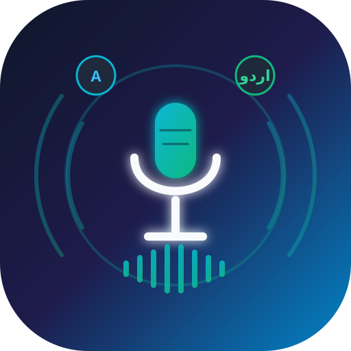

# 🎙️ VoiceLingo — Voice-to-Voice Translation & Smart Notes PWA

<p align="center">
  
</p>

<p align="center">
  <strong>A high-end, offline-ready Progressive Web App (PWA) for continuous voice recording, AI translation, text-to-speech, and WhatsApp sharing across Urdu, Roman Urdu, English, and Arabic.</strong>
</p>

<p align="center">
  
  
  
  
  
  
</p>

---

## 👨‍💻 Author & Feedback

- **Author:** **Waseem Asif**
- **Feedback Email:** [wasimasif761@gmail.com](mailto:wasimasif761@gmail.com)
- **WhatsApp Support:** Direct 1-click WhatsApp feedback integration built into the app

---

## 🌟 Key Features

### 1. 🗣️ Continuous Speech-to-Text (STT)
- **Long-Form Voice Dictation:** Configured with `recognition.continuous = true` and `recognition.interimResults = true`, allowing continuous speaking without auto-terminating during pauses.
- **Native Language Recognition:**
  - 🇵🇰 **Urdu (اردو):** `ur-PK`
  - 🔤 **Roman Urdu:** `en-US`
  - 🇬🇧 **English:** `en-US`
  - 🇸🇦 **Arabic (العربية):** `ar-SA`
- **Real-Time Web Audio Visualizer:** Connects directly to the microphone stream via `AudioContext` and `AnalyserNode` to render frequency waveforms on a dynamic canvas.
- **Editable Source Pad:** Real-time editable textarea with character counter, quick sample prompts, and instant voice-error corrections.

### 2. 🧠 Offline AI Translation (NLLB-200)
- **State-of-the-Art Neural Model:** Runs the `Xenova/nllb-200-distilled-600M` model client-side using `Transformers.js` with WebAssembly / WebGPU acceleration and browser cache.
- **Accurate Language Mapping:**
  - `Urdu (اردو)` ➔ `urd_Arab`
  - `Roman Urdu` ➔ `urd_Latn`
  - `English` ➔ `eng_Latn`
  - `Arabic (العربية)` ➔ `arb_Arab`
- **Dual Engine System:** Neural NLLB-200 for deep accuracy alongside an instant offline bilingual lexicon & phonetic transliterator that provides zero-latency responses even on low-spec hardware or offline environments.

### 3. 🔊 Voice Output (Text-to-Speech)
- Native Web Speech Synthesis with natural accent matching (`ur-PK`, `ar-SA`, `en-US`).
- Adjustable speech playback rates (`0.8x`, `1.0x`, `1.2x`).
- Active speaking wave animation and instant stop/replay controls.

### 4. 📲 Separate WhatsApp Sharing (واٹس ایپ پر علیحدہ علیحدہ شیئر کریں)
Specifically designed to share three distinct assets individually on WhatsApp:
1. **Share Text:** Formatted translation note containing original source text, target language translation, and app metadata.
2. **Share Voice Audio Clip:** Directly shares recorded microphone audio via the Web Share API or downloads `.webm` audio files ready for WhatsApp attachment.
3. **Share PWA App Link:** Quick invite text with the live application link and author credits.

### 5. 📝 Smart Notebook & History
- Auto-saves translations and voice notes into `localStorage`.
- Search across notes in Urdu, English, and Arabic.
- Star / Favorite important notes.
- One-click reload back into the active translation workspace.
- Export entire notebook as JSON backup.

### 6. 📱 Progressive Web App (PWA)
- Full offline functionality with Service Worker (`sw.js`).
- Installable on Android (Chromium `beforeinstallprompt`), Desktop, and iOS Safari (guided "Add to Home Screen" instructions).
- Native app feel with standalone display mode, custom theme colors, and icons.

---

## 📁 Repository Structure

```
├── public/
│   ├── icon.svg                 # Vector app brand icon
│   ├── pwa-192x192.png          # 192px PWA icon
│   ├── pwa-512x512.png          # 512px PWA icon
│   ├── apple-touch-icon.png     # iOS Safari touch icon
│   ├── manifest.json            # Web App Manifest
│   └── sw.js                    # Offline caching Service Worker
├── src/
│   ├── components/
│   │   ├── AudioVisualizer.tsx  # Web Audio Analyser canvas visualizer
│   │   ├── FeedbackModal.tsx    # Author profile & feedback modal
│   │   ├── LanguageSelector.tsx # Dual language selectors & swap
│   │   ├── NotesHistory.tsx     # Notebook history, search, and export
│   │   ├── PWAInstallButton.tsx # Cross-platform install button
│   │   └── ShareModal.tsx       # 3-in-1 WhatsApp sharing hub
│   ├── utils/
│   │   ├── audioRecorder.ts     # MediaRecorder & Web Audio service
│   │   ├── languages.ts         # Language registry & codes
│   │   ├── speech.ts            # SpeechRecognition & SpeechSynthesis
│   │   ├── translator.ts        # Transformers.js NLLB loader & fallback
│   │   └── whatsapp.ts          # WhatsApp formatters & share handlers
│   ├── types.ts                 # TypeScript type definitions
│   ├── App.tsx                  # Main VoiceLingo dashboard
│   ├── main.tsx                 # React entry point
│   └── index.css                # Tailwind CSS global styles
├── .github/
│   └── workflows/
│       └── ci.yml               # Automated CI build & lint check
├── index.html                   # HTML5 entry with PWA & font meta
├── package.json                 # Project dependencies & scripts
├── tsconfig.json                # TypeScript compiler configuration
├── vite.config.ts               # Vite configuration
├── LICENSE                      # MIT Open Source License
└── README.md                    # Project documentation
```

---

## 🚀 Getting Started

### Prerequisites
- Node.js `18.x` or higher
- npm or bun

### 1. Clone the repository
```bash
git clone https://github.com/wasimasif761/voicelingo.git
cd voicelingo
```

### 2. Install dependencies
```bash
npm install
```

### 3. Run development server
```bash
npm run dev
```
Open your browser at `http://localhost:3000`.

### 4. Build for production
```bash
npm run build
```

### 5. Preview production build
```bash
npm run preview
```

---

## 🌐 Deploying to GitHub

### Push to GitHub
```bash
git init
git add .
git commit -m "feat: initial commit of VoiceLingo PWA"
git branch -M main
git remote add origin https://github.com/<YOUR_USERNAME>/voicelingo.git
git push -u origin main
```

### Deploying to GitHub Pages, Vercel, or Netlify
- **Vercel / Netlify:** Import the GitHub repo; the build command is `npm run build` and output directory is `dist`.
- **GitHub Pages:** You can deploy the `dist/` directory via the included GitHub Actions workflow.

---

## 🛡️ License

This project is licensed under the [MIT License](LICENSE) © 2026 **Waseem Asif**.

---

<p align="center">
  Built with ❤️ for multilingual speech and translation accessibility.
</p>
